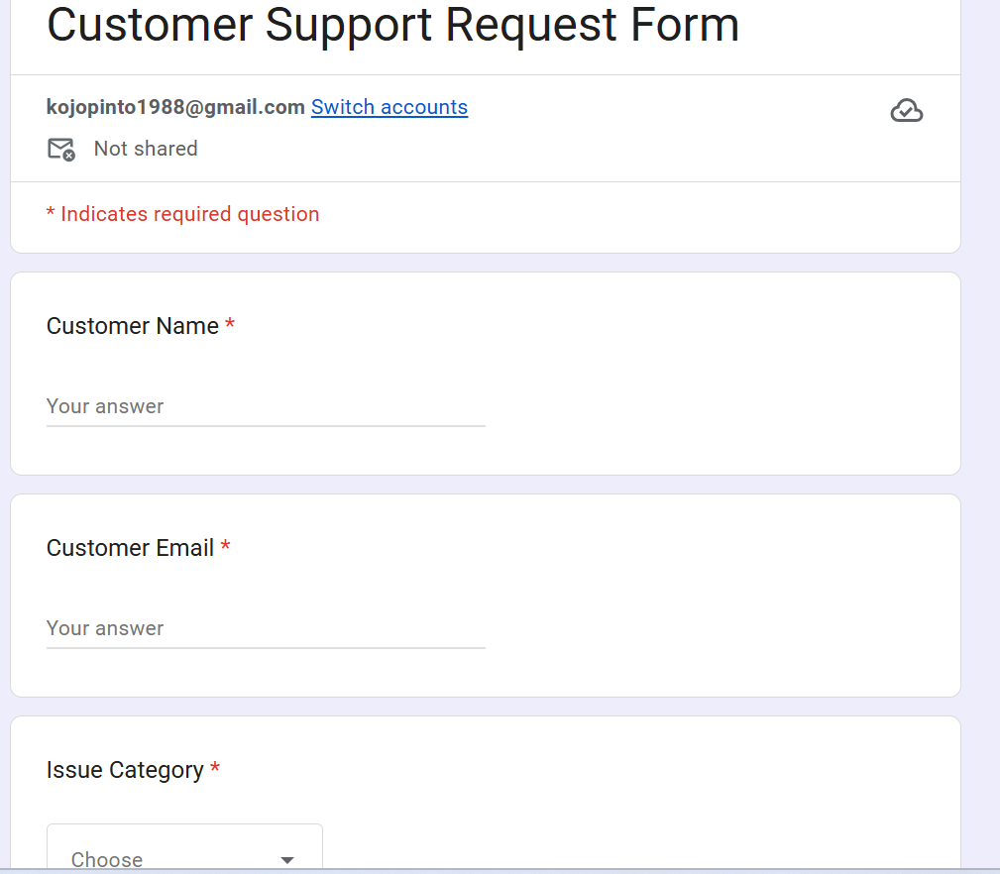
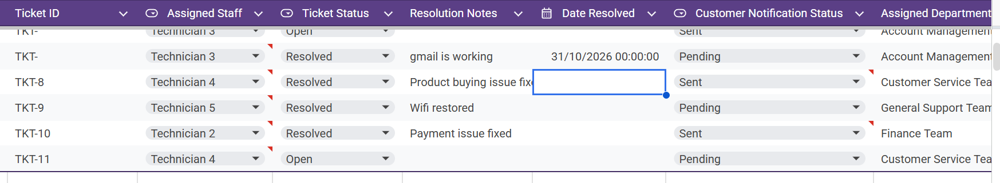
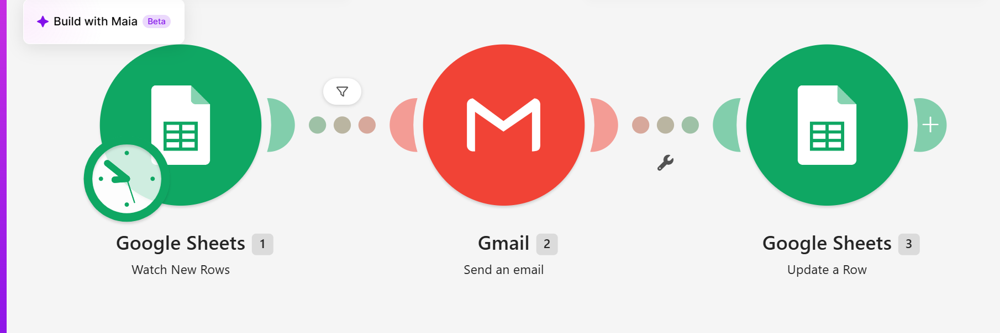
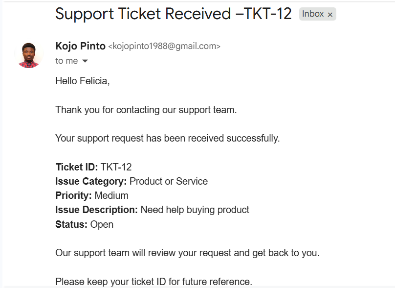
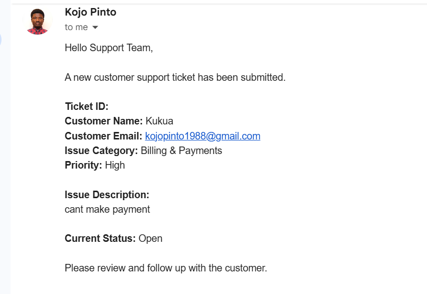
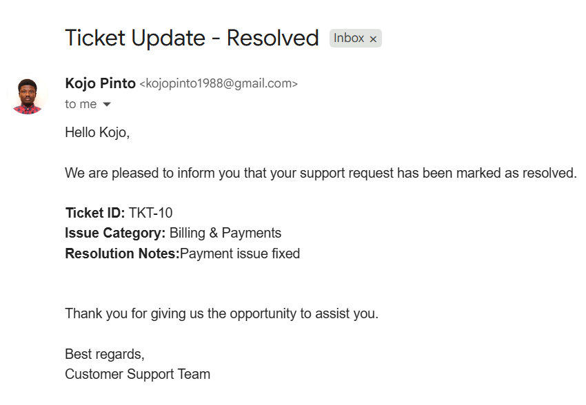

# Customer Support Ticket Management & Automated Response System

## Project Overview

This project is an automated customer support ticket management system built using Make.com, Google Forms, Google Sheets, and Gmail.

It helps businesses collect customer complaints, automatically generate support tickets, assign tickets to the appropriate departments and technicians, send email notifications, and track ticket resolution.

The goal is to reduce manual administrative work, improve response times, and create a more organized customer support process.

## Tools & Technologies

- Make.com – Workflow automation and ticket routing
- Google Forms – Customer complaint collection
- Google Sheets – Ticket database and status tracking
- Gmail – Automated email notifications

## Key Features

- Automated customer support ticket creation
- Unique ticket ID generation
- Automatic department and technician assignment
- Category-based ticket routing
- Customer confirmation emails
- Business and technician notifications
- Ticket status tracking
- Resolution notes and date tracking
- Automated customer resolution notifications
- Prevention of repeated resolution emails

## Department & Technician Assignment

| Issue Category | Department | Assigned Staff |
|---|---|---|
| Technical Support | IT Support Team | Technician 1 |
| Billing & Payments | Finance Team | Technician 2 |
| Account Access | Account Management Team | Technician 3 |
| Product or Service | Customer Service Team | Technician 4 |
| Other | General Support Team | Technician 5 |

*Technician names are placeholders used for demonstration.*

## How It Works

### Workflow 1: Ticket Registration and Assignment

1. Customer submits a support request through Google Forms.
2. Make.com detects the new response.
3. A unique ticket ID is generated.
4. A router evaluates the issue category.
5. The ticket is assigned to the appropriate department and technician.
6. The customer receives a confirmation email.
7. The business receives a support notification.

### Workflow 2: Ticket Resolution

1. Support staff update the ticket status to Resolved.
2. They enter resolution notes and the resolution date.
3. Make.com identifies resolved tickets awaiting customer notification.
4. Gmail sends the customer a resolution email.
5. Google Sheets updates the notification status to Sent.

## Project Documentation

Detailed project documentation is available in the `documentation` folder:

- [Business Rules](documentation/business-rules.md)
- [Workflow Overview](documentation/workflow-overview.md)
- [Workflow Diagram](documentation/workflow-diagram.md)

## Screenshots

### Customer Support Form

### Ticket Tracking Spreadsheet

### Ticket Registration Workflow

### Ticket Resolution Workflow

### Customer Confirmation Email

### Business Notification Email

### Customer Resolution Email

## Business Benefits

- Reduces manual ticket registration and assignment.
- Improves accountability across support teams.
- Provides customers with timely updates.
- Makes ticket progress easier to monitor.
- Helps businesses manage customer complaints more efficiently.

## Future Improvements

- Replace placeholder technicians with actual staff.
- Add technician workload balancing.
- Introduce escalation notifications for overdue tickets.
- Build a customer support performance dashboard.
- Integrate with a CRM or helpdesk platform.

## Author

**Solomon Pinto**

MS Data Analytics | IT Support | Business Process Automation | AI Automation

[GitHub Profile](https://github.com/KOJOPINTO)
